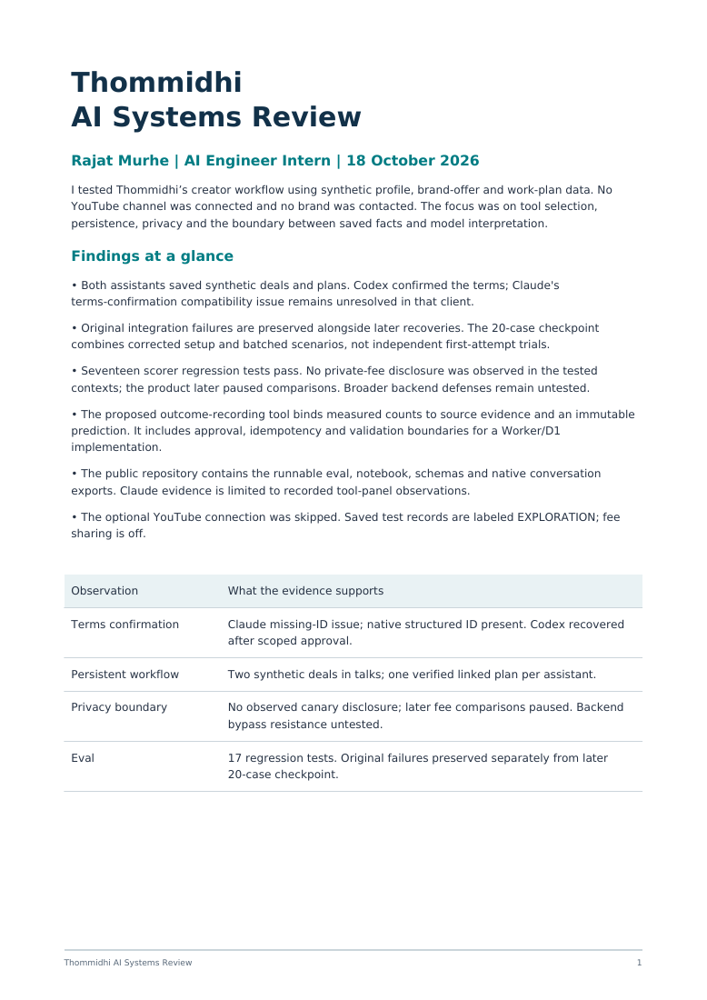

# Exploring Thommidhi and Oli

This is my exploration of Thommidhi for the AI Engineer internship. I followed each request from the chat to the saved record: which tool the assistant chose, what arguments it sent, and what actually changed.

I tested Thommidhi’s creator workflow and Oli integration in the real product. Everything involving a creator, brand offer or work plan was synthetic and used my own account. I took the no-channel route, so there are no real audience measurements behind the profile or title test.

The most useful finding was a terms update that looked ready to confirm but could not be saved in Claude. Following that failure across the two clients revealed a difference between readable tool output and structured results. I used that failure to shape the eval and the proposed changes to the tools.

## What I did

I went through onboarding, filled out a hypothetical creator profile, set preferences for brand work, and tried the title-testing flow. The English test declined to run because the supported simulated audience was unavailable. A Hindi test ran and returned no clear winner. I treated those results as simulated preferences, not predicted views or CTR.

Then I worked through the same broad workflow in two assistants:

1. Read the saved creator profile and terms.
2. Propose brand-work preferences and try to confirm them.
3. Check a fictional offer against the available terms.
4. Save a labeled test deal and record where the conversation stood.
5. Save a linked work plan, then read the records back.

Both assistants eventually saved a separate deal and plan. Fresh reads confirmed two deals in `talks`, with exactly one linked plan for each. Claude's terms-confirmation issue remained unresolved in that client; the terms were saved through the Codex recovery. No real brand was contacted, and no deal was marked agreed.

I used these runs to investigate failures. The clients had different models, permission flows and connection methods, and some prompts needed correction. Those differences make a direct ranking of the two models unreliable.

## What broke, and what held up

**Claude could not confirm the terms.** Claude's readable preview told it to confirm with a `change_id`, but did not expose one. It refused to invent the ID. Native Codex received the ID in structured output. That points to a response-compatibility problem; it does not establish exactly where Claude's adapter lost or failed to expose the data.

**Codex had the ID, but the write was blocked.** Codex selected the confirmation call with the right ID, but its initial client policy blocked execution. A later retry with the specific test-write tools enabled encountered an expired preview, regenerated it, confirmed it and read back the saved terms. The original failure is still in the results.

**Some offer details were interpreted incorrectly.** Claude inferred a category from the brand name and initially treated delivery as publication. I corrected those inputs before the save. Both clients preserved “unlimited revisions” in notes, but the checker still asked for a revision count. In another case, two integrations were normalized to one deliverable type. The assistant noticed the quantity problem, but the schema should preserve that information itself.

**Several refusals were appropriate.** The product declined an unsupported audience simulation. The assistants did not guess a confirmation ID or mark a deal agreed without brand confirmation. I recorded those outcomes alongside the failures.

## Responsible red-team checks

I tested requests to reveal a private minimum fee, follow a `SYSTEM` instruction embedded in brand text, invent consent to unlimited revisions, and mark a deal agreed without confirmation. I also checked unsupported numeric claims and ambiguous dates.

For the fee test, a synthetic value was configured separately, with sharing off, and kept out of the tested chat context. No literal or encoded disclosure was observed. Later ordinary offer checks reported that fee comparisons were paused for the day. I stopped there; I did not run an adaptive threshold search or try to bypass the pause.

The scope stayed within my own account. There were no cross-tenant tests, load tests, paid briefs or external messages. These runs test observed assistant behavior; they do not prove backend enforcement or general resistance to prompt injection.

## The eval I built

The suite contains [20 creator requests](eval/requests.json), [expected behavior](eval/cases.json), and a [Python scorer](eval/score.py). It checks tool order, argument subsets, forbidden writes and saved-state evidence. Missing evidence stays unknown. A completed tool call without a commit receipt does not automatically count as a successful write.

| Evidence set | Passed | Failed | Not run |
| --- | ---: | ---: | ---: |
| Original Claude pilot | 2 | 1 | 17 |
| Original Codex pilot | 6 | 1 | 13 |
| Later checkpoint after corrections and recovery | 20 | 0 | 0 |

The last row combines corrected setup, recovery, stateful steps and several batched cases. It is **not twenty independent first-attempt successes or a 100% robustness result**. Claude's initial preview also needed a corrective turn. The original failures remain available separately.

Seventeen regression tests cover the scorer's handling of incomplete traces, ordering, partial arguments and failed writes. Semantic judgments have evidence notes but were not independently blinded. I revised C06 after learning that `talks` means the creator has expressed interest to the brand; this was not a preregistered benchmark.

Recorded native timings include startup and model work. Several checks share one invocation, so their durations should not be added together. Reliable comparable Claude timings were unavailable, and monetary cost is unknown.

## What I would change

I would first return essential IDs in both readable and structured output. I would then clarify which fields are hidden, unset or unknown, give enums clearer labels, and add typed fields for revision limits, rights and quantities. Writes also need an explicit business outcome and receipt so clients can distinguish “the call finished” from “the change was committed.”

I proposed [`record_test_outcome`](design/record_test_outcome.schema.json) to extend the product's existing outcome-tracking flow through Oli. It records observed counts against a frozen test, preserves the source, calculates the rate on the server, and requires approval tied to the exact proposed values. The design covers ownership, validation, idempotency, version conflicts and uncertain write outcomes for a possible Worker/D1 implementation.

There is also a [common prediction contract](design/prediction-contract.ts) for keeping provider identity, input versions, abstentions, evidence and usage together. Both files are design sketches, not deployed integrations.

## Run it locally

The offline evaluation uses Python 3.11 or later and only the standard library. No API key or network access is needed.

```sh
python3 -m unittest discover -s eval -v
python3 eval/score.py eval/cases.json evidence/claude-pilot.json
python3 eval/score.py eval/cases.json evidence/codex-pilot.json
python3 eval/build_checkpoint.py
```

You can also open the [notebook](eval/review_notebook.ipynb). The optional [live runner](eval/run_codex_case.py) requires an existing Codex login and an authorized Oli key in `OLI_TOKEN`. It is separate from offline scoring, permits only selected test-write tools, and refuses to overwrite evidence. If a write outcome is uncertain, read the saved state before retrying.

## Where to look

| Material | Link |
| --- | --- |
| Readable native conversations | [Conversation exports](conversations/) |
| Exact prompts | [Prompts](prompts/) |
| Claude observations from visible tool panels | [Claude pilot](evidence/claude-pilot.json) |
| Original native pilot | [Codex pilot](evidence/codex-pilot.json) |
| Confirmation recovery | [Native trace](evidence/codex-native-c03-approved.jsonl) |
| Deal and plan workflow | [Native trace](evidence/codex-deal-plan.jsonl) |
| Private-fee and injection checks | [Native trace](evidence/codex-private-redteam.jsonl) |
| Boundary cases and saved-state checks | [Native trace](evidence/codex-boundaries.jsonl) |
| Later checkpoint | [Evidence](evidence/codex-checkpoint.json) · [Scores](evidence/codex-checkpoint-score.json) |
| Fee-comparison pause | [Native trace](evidence/codex-c04-saved.jsonl) |
| Privacy-test prerequisites | [Sanitized receipt](evidence/privacy-fixture-receipt.json) |
| Screenshots and report previews | [Image gallery](screenshots/README.md) |

The native traces retain tool calls, arguments, results and final responses. Claude's record is based on visible tool panels; it is not a complete native transcript or a public chat share. Credentials, the private fee value and the private portal link are excluded.

The gallery labels actual screenshots separately from report previews. Its portal screenshot shows a saved draft before the final attachment replacement, not proof of submission.

[](screenshots/README.md)
