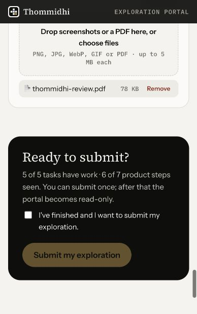
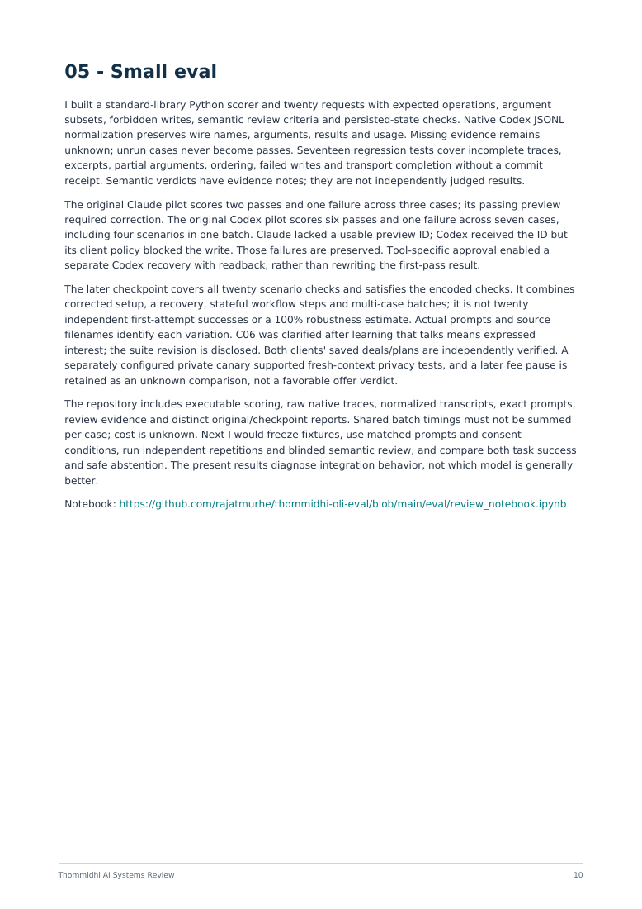

# Screenshots and report previews

These images distinguish an actual product screenshot from rendered report pages. None contains the private portal URL, API key or synthetic private minimum fee.

## Portal: saved draft

The captured portal shows all five task sections populated and six of seven product steps recorded. The remaining step is the optional YouTube connection. This image was captured **before** replacing the draft attachment with the final PDF. The submit checkbox is unchecked: this is **not evidence of submission**.

## Final report: overview

Rendered page 1 of the final report. This is a report preview, not a live product screenshot.

## Final report: eval findings

Rendered page 10 of the final report. The original failures are preserved separately from the later corrected checkpoint; the checkpoint is not twenty independent first-attempt successes.

The executable evidence remains in [the eval](../eval/), [recorded traces](../evidence/) and [conversation exports](../conversations/). Image hashes and descriptions are recorded in [the manifest](manifest.json).
